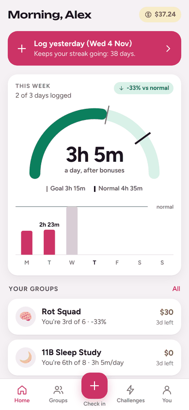
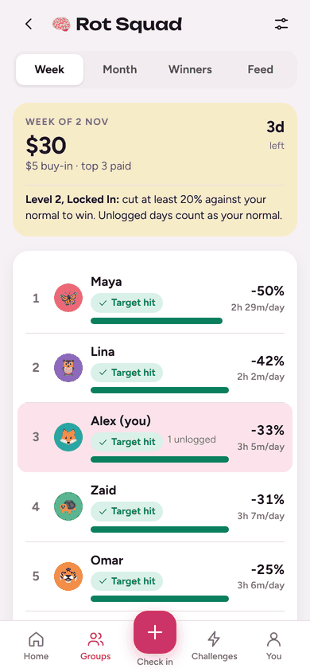
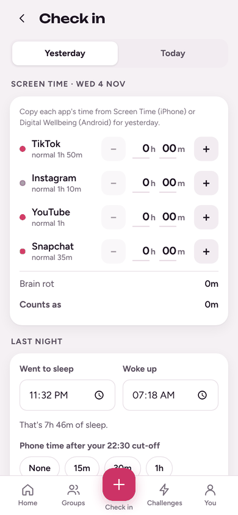
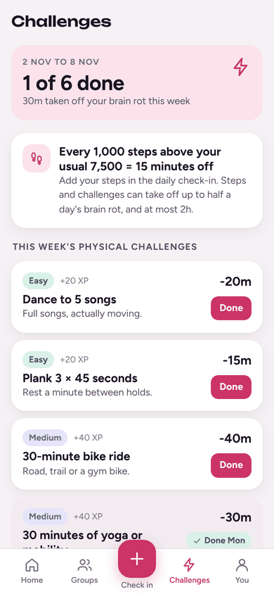
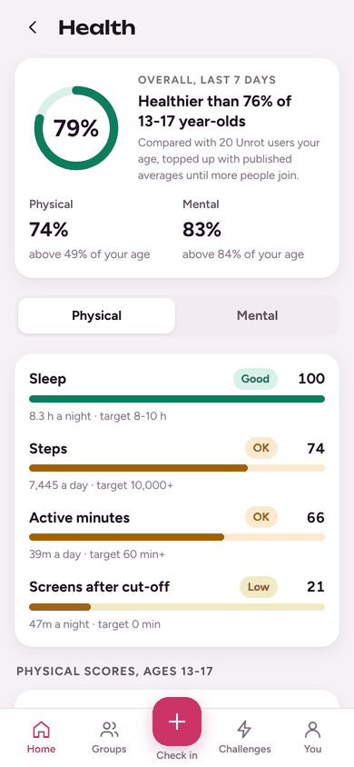
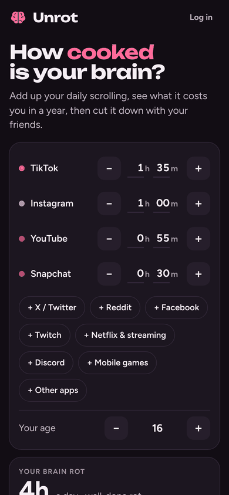

# Unrot

**Track your brain rot time, compete with friends to cut it, level up, and put (simulated) money on it.**

An **Android app that measures your screen time by itself**, and the same app
as an installable web app for iPhones. On Android, Unrot reads your app time
from the phone (the data behind Digital Wellbeing); on iPhone you copy it from
Screen Time each morning. Either way you add sleep, steps and a four-question
mood check. Friend groups compete every week and month for a pot; physical
challenges take minutes off; deposits make you put money on your goal; a
one-week Sleep Reset measures sleep and late-night screen use before and after
a nightly cut-off.

<p>



</p>
<p>



</p>

## Run it

Needs **Node.js 22.13 or newer** (it uses Node's built-in SQLite, so there is
nothing native to compile).

```bash
cd unrot
npm install
npm run dev          # http://localhost:5173, hot reload, starts with the demo world
```

In development the database is seeded with five weeks of demo history. Log in as
**alex@demo.unrot** / **demo-password**, or create your own account. The
welcome page also has **Try the demo**, which runs the whole app inside your
browser with no account.

```bash
npm test             # rules, usage maths, settlement, deposits, server + SQLite (38 tests)
npm run typecheck    # four strict TypeScript projects
npm run build        # dist/client (the PWA) + dist/server.mjs
npm start            # production server on :3000, data in ./data/unrot.db
npm run build:demo   # dist/demo/unrot-demo.html: the app as one self-contained file
npm run screenshots  # walk every screen in Chromium (needs a server with SEED_DEMO=1)
npm run build:android                  # web app into the Android project (then Gradle or Android Studio)
node scripts/android-sim.mjs URL DIR   # the Android flows in Chromium, with a simulated phone
```

| Variable | Default | |
|---|---|---|
| `PORT` | 3000 (5173 in dev) | |
| `DATA_DIR` / `DB_FILE` | `./data` / `$DATA_DIR/unrot.db` | Put this on a persistent disk |
| `TRUST_PROXY` | off | Set `1` behind Render/Fly/Railway so rate limits see real IPs |
| `SEED_DEMO` | off | Set `1` to start an **empty** database with the demo world |
| `CORS_ORIGINS` | `https://localhost,capacitor://localhost` | Origins allowed to call the API from elsewhere; the Android app is `https://localhost` |

## Put it online so your friends can use it

The server is a single Node process with a SQLite file, so any host with a
persistent disk works.

- **Render**: New Web Service from this repo. Root directory `unrot`, build
  `npm ci && npm run build`, start `npm start`, add a 1 GB disk mounted at
  `/var/data` and set `DATA_DIR=/var/data`, `TRUST_PROXY=1`. (`render.yaml`
  has the same settings.)
- **Docker** (Fly.io, Railway, a VPS): `docker build -t unrot . && docker run -p 3000:3000 -v unrot-data:/data unrot`.

Then open the site on your phone and add it to the home screen (Safari: Share ›
Add to Home Screen; Chrome: menu › Install app). It works offline for viewing,
and invite links (`…/#/join/CODE`) open straight into the group.

## The Android app

`android/` is the same app packaged for Android with [Capacitor](https://capacitorjs.com),
plus one native plugin that reads Android's usage records. Nothing else changes:
groups, pots, deposits, challenges, health and the Sleep Reset work exactly as
on the web, and iPhone friends keep using the web app in the same groups.

**Install it**

1. On the phone, open GitHub in the browser and log in, then open
   **Actions › Unrot Android**, pick the latest green run and tap
   **unrot-android.apk** under its Artifacts. It downloads as the app itself.
2. Open the download. Android asks you once to allow installs from your
   browser, and may warn about installing an app from outside the Play Store:
   choose to install anyway.
3. Open Unrot, enter your server's address (the one from *Put it online*), or
   tap **Try the demo** to use it without a server.
4. When the app asks, tap **Turn on tracking**, find Unrot in the list and
   switch on **Usage access**.

Every push that touches `unrot/` runs that workflow: typecheck, all tests, the
APK build, and an Android 14 emulator that installs the APK, grants Usage
access, opens the demo and fails the run on a crash, a JavaScript error, or if
the app can't read usage data.

**Updates install over the old app only if every build is signed with the
same key.** Without a key, CI signs each build with a one-off debug key and you
uninstall before installing the next one. To set a key up once:

```bash
keytool -genkeypair -keystore unrot.keystore -alias unrot -keyalg RSA -keysize 2048 -validity 10000
base64 -w 0 unrot.keystore   # copy the output
```

Then add four repository secrets (Settings › Secrets and variables › Actions):
`UNROT_KEYSTORE_B64` (that output), `UNROT_KEYSTORE_PASSWORD`, `UNROT_KEY_ALIAS`
(`unrot`) and `UNROT_KEY_PASSWORD`. Keep the keystore file somewhere safe and
never commit it: anyone with the key can publish "updates" to your app.

**Building it yourself** needs JDK 21 and the Android SDK (Android Studio
installs both): `npm run build:android`, then open `android/` in Android Studio
and press Run, or `cd android && ./gradlew assembleDebug`.

**How the tracking works**

- The plugin (`android/app/src/main/java/app/unrot/UsageStatsPlugin.java`) only
  checks access, opens the Usage access screen, and returns raw usage events
  and app names. All the maths is in `src/shared/usage.ts`, with tests:
  sessions from "app opened / paused / screen off" events, split at midnight in
  your time zone, and phone time after your cut-off until 05:00.
- TikTok, Instagram, YouTube, Snapchat, X, Reddit, Facebook, Twitch, Discord and
  the big streaming apps (including Shahid) are recognised by package name;
  games by their Play Store category. In **Settings › Phone tracking** you can
  pick any other app to count as *Other apps*.
- Each time the app opens or comes back to the front it saves **yesterday**
  (finished days only, so live leaderboards never see half a day) and shows
  **today so far**. Open it at least once a day: days can only be saved for
  today and yesterday, the same rule as typed check-ins.
- **Measured numbers can't be edited.** A check-in can add sleep, steps and mood
  but not change the phone's minutes, and group leaderboards mark players whose
  days were measured as *Auto-tracked*.
- Onboarding can fill in *your normal* from last week's real usage.
- Optional reminders (morning check-in, nightly cut-off) are scheduled on the
  phone in Settings.
- **Privacy:** only each day's totals for the apps you track, and the minutes
  after your cut-off, leave the phone. Which other apps you use, and the extra
  apps you pick, stay on the phone.

## How it works

### Brain rot time

```
raw     minutes on your tracked apps that day
bonus   15 min per 1,000 steps above your usual daily steps
        + this week's physical challenges you finished that day
counts  raw − bonus, where the bonus is at most half of raw and at most 2 h
```

- A past day you didn't log **counts as your normal (baseline)**. Skipping the
  bad days never helps, in any competition.
- You can log **today and yesterday**. After that a day is final, which is what
  lets results settle.
- Your **baseline** is your typical daily minutes per app (from the phone's
  last-week average) and your usual steps. Each value can be corrected for 3
  days, then it locks, so nobody can raise it later to fake a bigger cut. Group
  members can see each other's baselines.

### Groups, levels and monetary rewards

- Anyone can create a group and share a 6-character invite code or link.
  Owners can make admins, remove members, change settings and delete the group;
  every change is posted to the group feed.
- **Scoring**: biggest **% cut** against each person's own baseline (default,
  fair when people start in different places), or **fewest hours** a day.
- **Levels** set the target you must hit to win money: Chill 10%, Locked In
  20%, Hardcore 35%, Monk Mode 50% (or 4 h / 3 h / 2 h / 1 h a day in hours mode).
- **Weekly buy-in** (optional) is charged on Monday to everyone who joined by
  then; join on the Monday and you are still in. Weeks run Monday to Sunday and
  **settle on Tuesday**, after everyone has had Monday to log Sunday.
- **Payout**: winner takes all, or top 3 split 60/30/10. Ties share the places
  they cover. A set share of every weekly pot (default 20%) builds a **monthly
  jackpot** for the month's best cut. If nobody hits the target, the pot rolls
  over.
- **Weekly and monthly winners** are kept per group, and a **public leaderboard**
  ranks everyone by fewest hours a day, filterable by age group, with a hall of
  fame of past weekly and monthly winners.

### Deposits: "cut at least X hours"

Lock an amount and promise to cut at least X hours of brain rot against your
baseline over the next **7 or 30 days**. The window starts **tomorrow**, so
nobody can bet on a day they already know. Two days after it ends: hit the
goal and the deposit comes back; miss it and it goes into the pot of the group
you chose (or a community jar), which is what funds the monetary rewards.

### Challenges

- **Physical, weekly**: six a week for everyone (2 easy, 2 medium, 1 hard,
  1 extreme) from a pool of 23, each worth a set number of minutes off by how
  demanding it is (15 min for a 10-minute walk up to 2 h for a 10 km run).
- **Steps**: every 1,000 steps above your usual is 15 minutes off.
- **Wellbeing**: three a week picked from your weakest health scores ("phone
  sleeps outside your room", "no social media before noon"). They earn XP.
- **Levels**: XP from check-ins, staying under your goal, keeping the cut-off,
  streaks, challenges, wins and kept deposits. Level L needs 50·L·(L−1) XP,
  from *Fully Cooked* to *Unrotted Legend*.

### Health %

Physical % (sleep 35, steps 30, active minutes 20, phone after cut-off 15) and
Mental % (brain rot time 35, mood 20, energy 15, focus 15, calm 15), from your
last 7 check-ins against guidelines for your age: AASM/CDC sleep hours, WHO 2020
activity, Paluch et al. 2022 step counts, and the Canadian 24-Hour Movement
Guidelines' 2 h of recreational screen time. You get a percentile against other
users in your age group; while fewer than 25 people share it, a reference
population simulated from published averages fills the gap and fades out as
real users arrive (`src/shared/health.ts`). Each weak score comes with tips and
matching challenges. It is labelled as a self-check, not a medical assessment.

### Sleep Reset week (the before/after study)

1. **Before**: a normal week of check-ins (or your last 7 days, if you logged
   at least 5 of them).
2. **Cut-off week**: phone down at your nightly cut-off, homework planned to
   finish an hour before it, daily check-in. The app shows how to set iPhone
   Downtime or Android Bedtime mode at the cut-off.
3. **Results**: sleep hours, phone minutes after the cut-off, bedtime, brain
   rot, nights kept and late-homework nights, before against after.

Run it with a group and the group gets a **Study** tab: averages across
everyone, a per-participant table anonymised as P1, P2…, and a CSV export.

The **study planner** schedules homework earliest-deadline-first into the
afternoons, between your study start time and an hour before the cut-off,
and warns you when something won't fit before it is due.

## Choices worth knowing about

- **Automatic on Android, typed on iPhone.** A web app cannot read other
  apps' usage on any phone, so automatic tracking is the Android app's job.
  iPhone only exposes usage to apps with Apple's Family Controls entitlement,
  and even then not as plain numbers, so iPhone users copy it from Screen Time
  (about 30 seconds a day). Mixed groups work: measured players are marked.
- **Steps count above your usual, not from zero.** Taken literally, 15 minutes
  per 1,000 steps means an ordinary 8,000-step day erases 2 hours, and in
  testing every member of a group "cut" 50-70% without changing their
  scrolling, which made every level target meaningless. Counting only the
  extra keeps the same rate while rewarding real effort. The bonus is also
  capped at half the day's brain rot and 2 hours. All of this is in
  `src/shared/balance.ts` (`CREDIT`) if you want to tune it.
- **Money is simulated.** Every account starts with $20 and can add more.
  Buy-ins, pots, deposits and payouts all work, but nothing is charged or paid.
  Real-money pots where losers pay winners can count as gambling, app stores
  restrict them for under-18s, and payouts need a licensed provider. The two
  places a real provider would plug in are marked `PAYMENT SEAM` in
  `src/engine/ops/wallet.ts`.
- **The nightly cut-off can't be enforced by a web app.** The app counts down
  to it, switches to a night banner after it, asks about it in the morning,
  and walks you through the phone's own Downtime/Bedtime settings.
- **Ages 13+.** Younger children need parental-consent flows (COPPA and
  similar) that this does not have.

## How the code is laid out

```
src/shared/    pure rules, no I/O: dates, scoring, health, challenges, planner,
               money splits, levels, every tunable number (balance.ts)
src/engine/    the whole backend as one function, handle(request) → response
  store.ts     in-memory collections + indexes + transactions with rollback
  settle.ts    opens weeks/months, charges buy-ins, settles pots, deposits,
               Sleep Resets; runs on every request (idempotent)
  ops/         accounts, check-ins, groups, wallet, health, sleep, planner
  seed.ts      the demo world, replayed day by day through the real engine
src/server/    node:http + node:sqlite persistence, scrypt passwords,
               rate limits, security headers, static hosting
src/client/    React PWA; talks to the server, or in demo mode runs the same
               engine in the browser with localStorage
  lib/native.ts, lib/tracking*.ts   the Android side: plugin, sync, reminders
src/shared/usage.ts   Android usage events -> minutes per app per day
android/       the Capacitor Android project and the UsageStats plugin
tests/         Vitest: engine scenarios, Android usage maths, the demo world
               in 4 time zones, the HTTP server with SQLite restarts
scripts/       server bundle, standalone demo, icons (web and Android),
               screenshot walkthrough, Android simulation, CI emulator script
```

The engine keeps all data in memory and writes only what each request changed
to SQLite, inside one transaction. That is simple and fast for friend groups
and classes (thousands of users); a much larger deployment would move the
store to Postgres. Settlement is lazy: nothing runs on a timer that can be
missed, every request first brings the world up to date.
